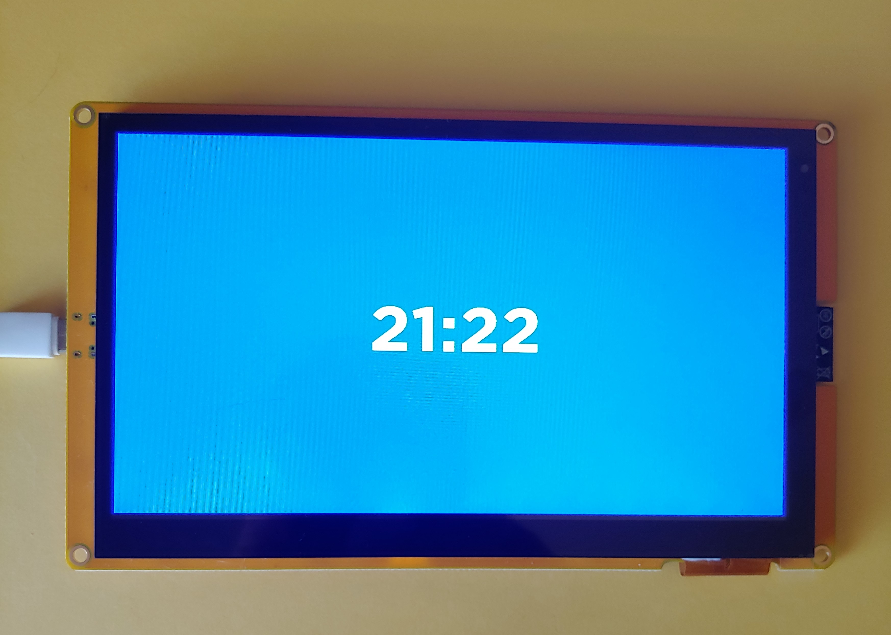

# Rust ESP32S3 Lvgl Demo

The purpose of this demo is to get lv-binding-rust (Lvgl) running on the ESP32S3 development board

## Development Board
Aliexpress ESP32-8048S070 - 7 inch 800x400 TN RGB with ESP32S3, 8M PSRAM, 16M Flash, 512KB SRAM

## Overview
This application shows how to use lv-binding-rust crate on a ESP32S3 device.  The program will display a clock time on a blue backgound screen.
The clock time is a simulated time of 21:00 to 21::59 where the seconds are incremented each second and repeats the 00-59 seconds forever.

## partition-table folder
The partition-table folder contains a file called partitons.csv.  This file increases the default factory/app partiton from the default of 1M to 3M. This allows us more space for our program and since the flash size is 16M this should not be a problem.  This file will be called when we flash the device.

## custom-fonts folder
The custom-fonts folder contains our custom fonts.  The customs fonts are converted from TTF fonts using lvgl online font converter at https://lvgl.io/tools/fontconverter.  I used https://ttfonts.net to find a font I liked and then downloaded the font.  In the lvgl-online-font-converter I used the font name plus the font size for the name of the font.  I chose Bpp of 2 bit-per-pixel and set the range of 0x30-0x3A since I only need numbers and the ":" character.  After clicking on "Convert" the file will be downloaded. I placed this downloaded file (*.c) into the custom-fonts folder.  Then I created a header file which has an extern to my *.c file, along with changing the ifndef and define names.  
To use this custom font, I added ```LVGL_FONTS_DIR = {relative = true, value = "custom-fonts"}``` to my config.toml under [env].  This allows our font to be compiled when lvgl is compiled.

## lvgl-configs folder
The lvgl-configs folder holds the lv_config.h and lv_drv_conf.h files which are required by lvgl to compile.  Everything in lv_drv_conf.h file is set to 0 as I am not using the lvgl drivers.  I don't think I changed anything in the lv_conf.h file.

## lcd_panel.rs file
The LCD RGB display driver.

## sdkconfig.defaults file
Increased the main task stack size to 60000 to allow app to run without crashing.

The following needs to be added for using PSRAM.
```
CONFIG_SPIRAM=y
CONFIG_SPIRAM_MODE_OCT=y
CONFIG_SPIRAM_SPEED_80M=y

# Enabling the following configurations can help increase the PCLK frequency in the case when
# the Frame Buffer is allocated from the PSRAM and fetched by EDMA
CONFIG_SPIRAM_FETCH_INSTRUCTIONS=y
CONFIG_SPIRAM_RODATA=y

CONFIG_ESP_DEFAULT_CPU_FREQ_MHZ_240=y
```

## Cargo.toml project file
I added the following to the "dependencies" section.
```
# Logging
log = "0.4"

# ESP specifics
esp-idf-svc = "0.51"

# LVGL
lvgl = { version = "0.6.2", default-features = false, features = [
    "embedded_graphics",
    "unsafe_no_autoinit",
    #"lvgl_alloc",
    #"alloc"
] }

lvgl-sys = { version = "0.6.2" }

# Hardware IO Abstraction Layer
embedded-hal = {version = "1.0.0"}
embedded-graphics-core = "0.4.0"

# Error
anyhow = "1.0"

# C String
cstr_core = "0.2.1"
```

Also included patch.crates-io section to patch esp-idf-sys, esp-idf-svc, esp-idf-hal, lvgl and lvgl-sys
```
[patch.crates-io]
lvgl = { git = "https://github.com/enelson1001/lv_binding_rust"}
lvgl-sys = { git = "https://github.com/enelson1001/lv_binding_rust"}

# Need to use Master branch if using esp-idf greater than version 5.2 (ie v5.4.2, v5.5.1)otherwise esp_lcd_panel_rgb.h is not included
esp-idf-sys = { git =  "https://github.com/esp-rs/esp-idf-sys.git"}

# Need to use Master branch if using esp-idf v5.5.1 or else you will get the following 2 errors
# error[E0422]: cannot find struct, variant or union type `twai_timing_config_t__bindgen_ty_1` in this scope
# error[E0560]: struct `esp_idf_sys::twai_timing_config_t` has no field named `__bindgen_anon_1`
esp-idf-hal = { git =  "https://github.com/esp-rs/esp-idf-hal.git"}
esp-idf-svc = { git =  "https://github.com/esp-rs/esp-idf-svc.git"}
```

## config.toml
To get lv-bindings-rust to comple and build I made the following changes to the config.toml file. 
```
[build]
target = "xtensa-esp32s3-espidf"

[target.xtensa-esp32s3-espidf]
linker = "ldproxy"
runner = "espflash flash --monitor"
rustflags = [ "--cfg",  "espidf_time64",]

[unstable]
build-std = ["std", "panic_abort"]

[env]
MCU="esp32s3"

# Note: this variable is not used by the pio builder (`cargo build --features pio`)
#ESP_IDF_VERSION = "v5.4.2"
ESP_IDF_VERSION = "v5.5.1"

# The directory that has the lvgl config files - lv_conf.h, lv_drv_conf.h
DEP_LV_CONFIG_PATH = { relative = true, value = "lvgl-configs" }

# Required to make lvgl build correctly otherwise get wrong file type (ie compiled for a big endian system and target is little endian)
CROSS_COMPILE = "xtensa-esp32s3-elf"

# Required for lvgl otherwise the build would fail with the error -> dangerous relocation: call8: call target out of range
# for some lvgl functions
CFLAGS_xtensa_esp32s3_espidf="-mlongcalls"

# Directory for custom fonts (written in C) that Lvgl can use
LVGL_FONTS_DIR = {relative = true, value = "custom-fonts"}

# Required for lvgl to build otherwise you will get string.h not found.
# Verfiy path and toolchain version being used on your PC (esp-14.2.0_20240906)
TARGET_C_INCLUDE_PATH = "/home/ed/.rustup/toolchains/esp/xtensa-esp-elf/esp-15.2.0_20250920/xtensa-esp-elf/xtensa-esp-elf/include"
```

## lv-binding-rust fork
I used my fork of lv-binding-rust

## Flashing the ESP32S3 device
I used the following command to flash the ESP32S3 device.
```
$ cargo espflash flash --partition-table=partition-table/partitions.csv --monitor
```

## Picture of Aliexpress ESP32S3 running the demo



# Versions
### v1.0 : 
- initial release

## Change History
Oct 13, 2025 
- Code cleanup
- Update lcd_panel.rs to use builder for easier user implementation for different LCD displays
- Tested with the following versions
    - Rust: rustc 1.90.0 (1159e78c4 2025-09-14)
    - espup: espup 0.16.0
    - esp-idf: v5.42 or v5.5.1